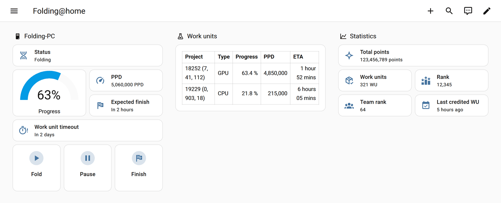
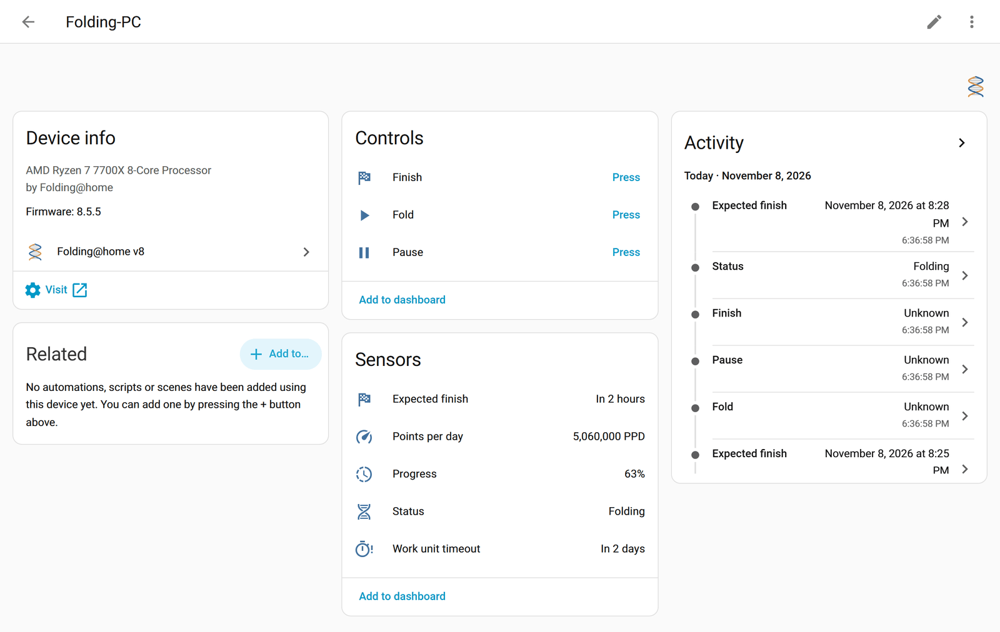
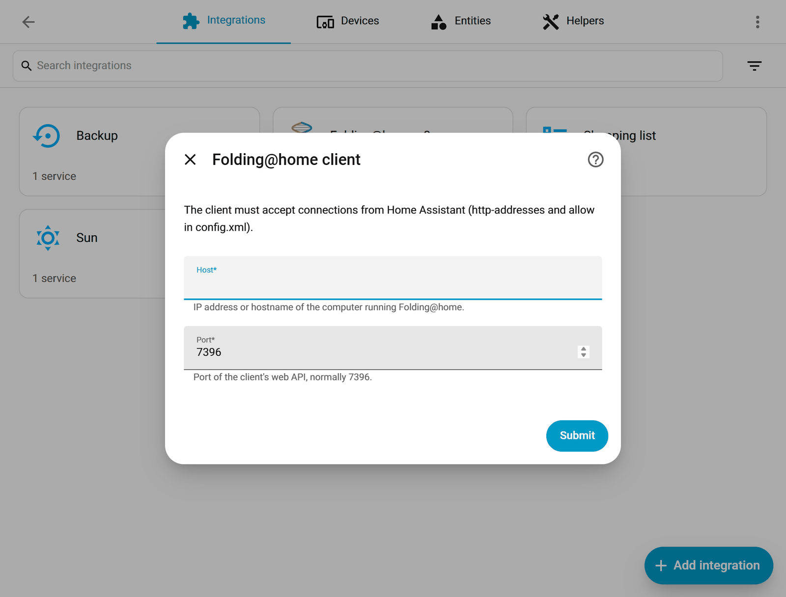
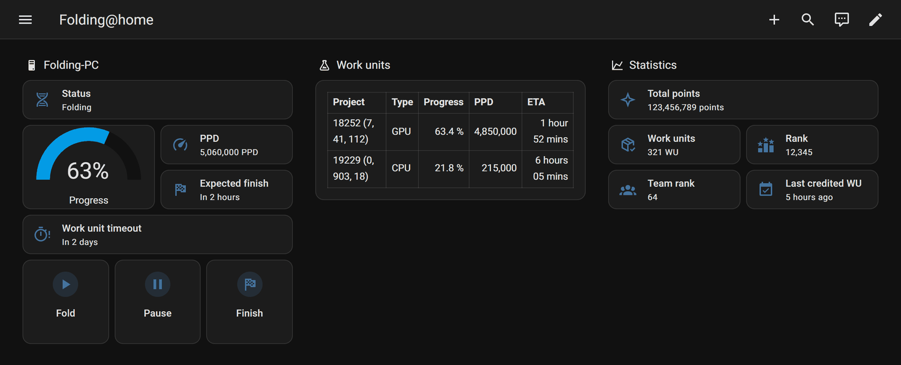
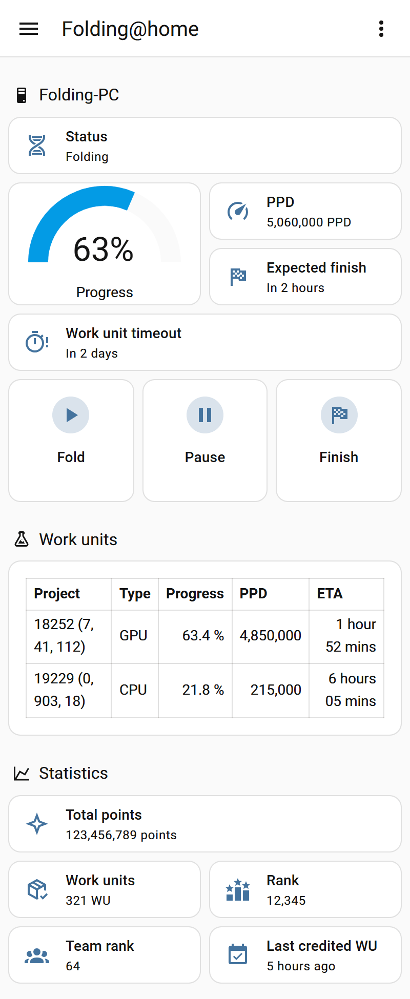

# Folding@home v8 for Home Assistant

[](https://github.com/Jochemp88/ha-foldingathome/actions/workflows/validate.yml)
[](https://github.com/Jochemp88/ha-foldingathome/actions/workflows/tests.yml)
[](https://github.com/Jochemp88/ha-foldingathome/releases/latest)
[](LICENSE)
[](#installation)

A custom integration that connects Home Assistant to a local
[Folding@home](https://foldingathome.org/) **v8** client. It keeps a websocket
open to the client's web API (port 7396), so status changes arrive instantly
instead of being polled, and it lets you start, pause or finish folding from
Home Assistant.

> This is a community project. It is not made or endorsed by the Folding@home
> consortium. The icon is original artwork, not the Folding@home logo.



## Features

- **Live status** of the client (local push): folding, finishing, downloading,
  uploading, waiting, paused, no work, offline. The pause reason and the active
  work units are available as attributes.
- **Progress**, **points per day** and **expected finish** of the running work
  units.
- **Work unit timeout**: when the work unit that is due first must be returned.
  It stays available while the computer is off, so you can warn yourself before
  a work unit expires.
- **Donor statistics** from the public Folding@home stats API: total points,
  work units, rank, team rank and the time of the last credited work unit. The
  donor name and team are read from the client; no account or passkey is needed.
- **Buttons** to *Fold*, *Pause* and *Finish* (finish the current work units,
  then stop).
- Reconnects automatically when the computer boots, so it works well with
  computers that are switched off part of the day.
- Address can be changed later via *Reconfigure*.
- English and Dutch translations.

## Screenshots

<details>
<summary>Device page, setup dialog, dark mode and mobile</summary>

The machine as a device, with its controls and sensors:



Adding the integration:



The [example dashboard](examples/dashboard.yaml) in dark mode and on a phone:





</details>

All screenshots use demo data.

## Requirements

- Home Assistant 2026.10 or newer.
- A Folding@home **v8** client (8.x) on a computer in your local network. The
  older v7 client (FAHClient 7.x, port 36330) is not supported.
- The client must accept connections from Home Assistant. By default the v8
  client only listens on `127.0.0.1`. You need to:
  1. add `http-addresses` and `allow` to the client's `config.xml`, and
  2. allow incoming TCP port 7396 from Home Assistant in the computer's
     firewall.

  See **[Preparing the Folding@home client](docs/client-setup.md)** for a
  step-by-step guide.

> **Security note:** anyone who can reach port 7396 can control the client.
> Only allow the address of your Home Assistant host, never your whole network
> or the internet.

## Installation

### Marketplace (Home Assistant 2026.11 and newer, recommended)

Since 2026.11, HACS is built into Home Assistant as the **Marketplace**.

1. Go to **Settings → Marketplace**.
2. Select **Add from link** (top right) and enter
   `https://github.com/Jochemp88/ha-foldingathome` as the **GitHub link**.
   If asked for a **Type**, choose **Integration**. Select **Add**.
   Adding a link needs an administrator account and a GitHub connection; the
   repository then appears under **Added from links**.
3. Open **Folding@home v8** and install it, then follow the setup steps below.

### HACS (Home Assistant 2026.10)

1. Open **HACS** → ⋮ → **Custom repositories**.
2. Add `https://github.com/Jochemp88/ha-foldingathome` with type
   **Integration**.
3. Search for **Folding@home v8**, open it and click **Download**.
4. Restart Home Assistant.

Existing HACS installations move to the Marketplace automatically when you
update Home Assistant to 2026.11.

### Manual

Copy `custom_components/foldingathome_v8` into the `custom_components` folder
of your Home Assistant configuration and restart Home Assistant.

## Configuration

1. Go to **Settings → Devices & services → Add integration** and pick
   **Folding@home v8**.
2. Enter the IP address (or hostname) of the computer running Folding@home and
   the port (normally `7396`).

The client must be running while you add it. Each machine gets its own device,
named after the machine name in Folding@home. To change the address later, open
the integration and choose ⋮ → **Reconfigure**.

A reserved (static) IP address for the folding computer in your router is
recommended.

## Entities

Per machine (entity IDs start with `<machine>_`, depending on your machine name):

| Entity | Type | Description |
| --- | --- | --- |
| Status | sensor (enum) | `folding`, `finishing`, `downloading`, `uploading`, `waiting`, `paused`, `idle`, `offline`. Attributes: `units`, `pause_reason`. |
| Progress | sensor (%) | Progress of the main work unit. |
| Points per day | sensor (PPD) | Estimated PPD of all running work units. Attribute: `running_units`. |
| Expected finish | sensor (timestamp) | Expected finish of the running work. |
| Work unit timeout | sensor (timestamp) | Timeout of the work unit that is due first. Attributes: `deadline`, `remaining_hours`, `prcg`. |
| Fold | button | Start or resume folding. |
| Pause | button | Pause folding. |
| Finish | button | Finish the current work units, then stop. |

A separate *Folding@home statistics* device (available once the donor name has been read from the client):

| Entity | Type | Description |
| --- | --- | --- |
| Total points | sensor | Donor score. |
| Work units | sensor | Number of credited work units. |
| Rank | sensor | Donor rank. Attribute: `donors`. |
| Team rank | sensor | Donor rank within the team. Attributes: `team`, `team_id`, `team_score`, `team_wus`. |
| Last credited work unit | sensor (timestamp) | When the last work unit was credited. |

Statistics are refreshed every 30 minutes.

## Example dashboard

[`examples/dashboard.yaml`](examples/dashboard.yaml) contains the dashboard
from the screenshots: status, progress, PPD, expected finish, work unit timeout,
the three buttons, a table of the running work units and the donor statistics.
Create a new dashboard, open ⋮ → **Edit dashboard** → ⋮ → **Raw configuration
editor**, paste the file and replace `folding_pc` with the entity ID prefix of
your machine.

## Example automations

Fold only while there is a solar surplus (replace the entity IDs with your own):

```yaml
automation:
  - alias: "Folding@home: fold on solar surplus"
    triggers:
      - trigger: numeric_state
        entity_id: sensor.power_export
        above: 1000
        for: "00:10:00"
    actions:
      - action: button.press
        target:
          entity_id: button.my_pc_fold

  - alias: "Folding@home: finish when the surplus is gone"
    triggers:
      - trigger: numeric_state
        entity_id: sensor.power_export
        below: 200
        for: "00:10:00"
    actions:
      - action: button.press
        target:
          entity_id: button.my_pc_finish
```

Warn when a work unit is about to time out while the computer is off:

```yaml
automation:
  - alias: "Folding@home: work unit timeout warning"
    triggers:
      - trigger: template
        value_template: >
          {{ states('sensor.my_pc_work_unit_timeout') not in ['unknown', 'unavailable']
             and as_datetime(states('sensor.my_pc_work_unit_timeout')) - now() < timedelta(hours=6) }}
    conditions:
      - condition: state
        entity_id: sensor.my_pc_status
        state: offline
    actions:
      - action: notify.notify
        data:
          message: "A Folding@home work unit times out within 6 hours. Turn on the PC to finish it."
```

## Troubleshooting

- **Cannot connect** when adding the integration: check that the client is
  running, that `config.xml` contains `http-addresses` and your Home Assistant
  address in `allow`, that the client was restarted afterwards, and that the
  firewall allows TCP 7396 from Home Assistant.
- **All entities unavailable**: the computer is off or the client is not
  running. The integration reconnects by itself within seconds after the client
  starts.
- **Statistics unavailable**: the client has no donor name configured
  (anonymous folding), the donor name has not been read from the client yet, or
  the stats API is temporarily unreachable.

## Development

```bash
pip install -r requirements_test.txt
python -m pytest
```

`tools/make_brand.py` (needs Pillow) redraws the icons in
`custom_components/foldingathome_v8/brand/`.

## License

[MIT](LICENSE). The sample client traffic in `tests/data` comes from
[lufah](https://github.com/kbernhagen/lufah) (MIT), see
[tests/data/NOTICE.md](tests/data/NOTICE.md).
